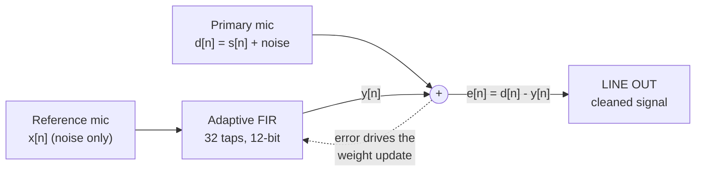
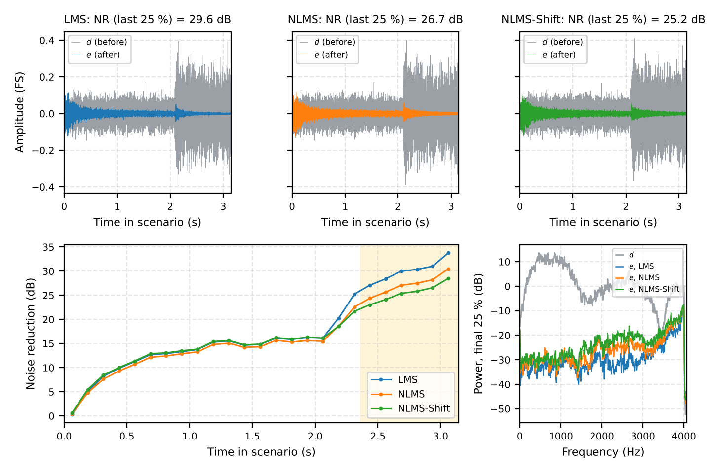
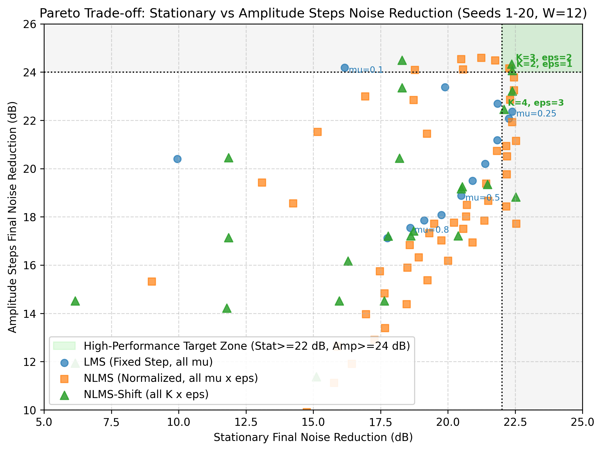
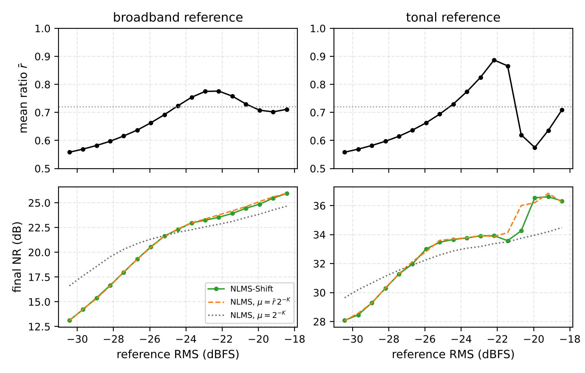
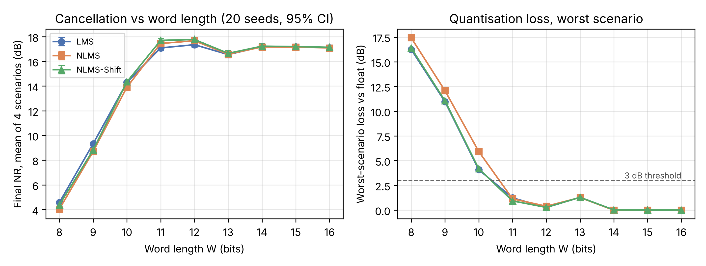

# ULLAP: an FPGA adaptive noise canceller

ULLAP is a small, processor-free noise canceller that runs on the Terasic DE2-115 board
(Cyclone IV E EP4CE115F29C7) with its WM8731 audio codec. It takes a noisy signal and a
reference microphone, learns the noise path with a 32-tap adaptive filter in 12-bit fixed
point, and subtracts the estimate one sample at a time, 37 clock cycles after each input.

One serial core with a single shared multiplier runs three algorithms, selected by a
parameter at build time:

- **LMS**, the plain least-mean-square update;
- **NLMS**, normalised LMS with a restoring divider;
- **NLMS-Shift**, NLMS where the division is replaced by a leading-one detector and a shift.

The repository holds everything behind the study: the Verilog, the bit-exact Python model it
is checked against, the experiments and their raw results, the Quartus project, the on-board
Signal Tap captures, the journal manuscript and the class presentation.



## What we found

All numbers are 20-seed means at W = 12 bits and L = 32 taps, with step sizes tuned on
held-out seeds. The full numbers, with 95% confidence intervals, are in
[`results/paper_numbers.csv`](results/paper_numbers.csv) and the manuscript in [`paper/`](paper/).

| | LMS | NLMS | NLMS-Shift |
|---|---|---|---|
| Final noise reduction, stationary noise | 22.39 dB | 22.28 dB | 22.37 dB |
| Final noise reduction, amplitude steps | 22.36 dB | 24.16 dB | 24.33 dB |
| Busy cycles per sample (measured on the board) | 73 | 130 | 72 |
| Input-to-output latency (cycles at 50 MHz) | 35 | 37 | 37 |
| Logic elements (board build) | 1,792 | 2,626 | 2,610 |
| Fmax, slow 85 °C | 70.08 MHz | 59.75 MHz | 58.66 MHz |
| Dynamic energy per sample, gate level, max rate | 20.7 nJ | 38.0 nJ | 28.4 nJ |

In short:

- NLMS-Shift stays within the confidence interval of NLMS on stationary and amplitude-step
  noise and beats LMS by about 2 dB when the noise level jumps, while finishing each sample in
  72 instead of 130 cycles and using 22 to 25% less dynamic energy per sample than NLMS.
- NLMS-Shift turns out to be exactly NLMS with a level-dependent step between 0.5 and 1 times
  the nominal one ([`py/exp_equiv_step.py`](py/exp_equiv_step.py), figure 16).
- On real recorded noise mixed with speech (MS-SNSD) the filters remove 11.7 to 14.9 dB and
  lift STOI from 0.69–0.78 to 0.95–0.98. With the speech removed they reach 18.5 to 31.9 dB,
  so the speech, not the noise, sets the limit.
- On the board, all 724,459 output samples captured with Signal Tap across the three
  algorithms match the integer model bit for bit. The measured sample rate (8,138 Hz),
  latency and busy cycles agree with the RTL, also after a 10-minute soak.

<p align="center">
  
  
</p>
<p align="center">
  
  
</p>

## Repository map

| Folder | What is in it |
|---|---|
| [`rtl/`](rtl/) | `anc_core.v`, the portable Verilog core (no vendor IP) |
| [`tb/`](tb/) | Self-checking testbenches, test manifests, fault-injection mutants |
| [`vectors/`](vectors/) | Golden input/output vectors for the RTL and power runs, test audio |
| [`quartus/`](quartus/) | DE2-115 project: top level, codec I²C and I²S, pins, timing and power scripts |
| [`py/`](py/) | Float and bit-exact integer models, experiments, regression runners, unit tests |
| [`results/`](results/) | Metrics (CSV/JSON), figures, Quartus reports, board analysis, archived logs |
| [`board/`](board/) | On-board evidence: Signal Tap sessions, stimulus files, capture scripts |
| [`paper/`](paper/) | Journal manuscript (Elsevier and IEEE versions sharing one body) |
| [`presentation/`](presentation/) | Class presentation (PowerPoint and PDF) |
| [`docs/`](docs/) | Design notes, verification record, board test plan, claims, project history |

Each folder has its own short README.

## Getting started

You need Python 3.10 or newer. Everything on the software side runs on Windows, Linux or macOS.

```bash
python -m venv .venv
source .venv/bin/activate          # Windows: .venv\Scripts\activate
pip install -r requirements.txt    # pesq may fail to build on very new Pythons; only the real-audio study needs it
```

**Run the unit tests** (bit-exactness of the model, rounding, saturation, vector round trips,
board-capture parsers):

```bash
python -m pytest -q py
```

**Re-run the simulation study.** This tunes the step sizes, runs every scenario in float and
fixed point, sweeps the word length and redraws the figures in `results/plots/`. It
overwrites files under `results/`, so commit or stash first if you want to compare.

```bash
python py/run_pipeline.py --quick                                  # smoke run, a couple of minutes
python py/run_pipeline.py --wav vectors/audio/acoustic_chord.wav   # full study
```

The individual journal experiments (word length, real audio, paired statistics, equivalent
step, power activity) each have their own script in `py/`; see [`py/README.md`](py/README.md).

**Run the RTL regression.** Icarus Verilog is enough; Questa is supported too.

```bash
python py/run_iverilog_regression.py     # 86 tests: core, protocol, freeze/hold, top level with codec model
python py/run_questa_regression.py       # same tests on Questa (set ANC_VSIM etc. for your install)
python py/run_verilator_lint.py          # Verilator -Wall lint with reviewed waivers
```

**Build for the board.** From `quartus/`, with Quartus Prime Lite on the path. The arguments
are `ALGO W K EPS_EXP MU_INT`, with ALGO 0 = LMS, 1 = NLMS, 2 = NLMS-Shift:

```bash
cd quartus
quartus_sh -t build_quartus.tcl 2 12 3 2 512   # NLMS-Shift, the tuned settings
quartus_sh -t build_quartus.tcl 1 12 3 0 256   # NLMS
quartus_sh -t build_quartus.tcl 0 12 3 2 256   # LMS
```

The bench procedure (tests T1 to T11, Signal Tap set-up, what to record) is in
[`docs/board_test.md`](docs/board_test.md), and [`board/README.md`](board/README.md) shows how
to re-run the analysis of the captures we already have.

**Build the manuscript.**

```bash
cd paper
python make_tables.py
latexmk -pdf ullap_manuscript.tex ullap_ieee.tex
```

## How the numbers are kept honest

Every figure in the docs is labelled by where it comes from: Python simulation, Quartus
synthesis and timing reports, the Quartus power analyser, or a measurement on the board.
Raw Quartus reports are archived in `results/quartus_reports/`, and
[`py/audit_db_numbers.py`](py/audit_db_numbers.py) cross-checks the numbers quoted in the
markdown files against the CSVs they came from. [`docs/claims.md`](docs/claims.md) lists what
the project does and does not claim.

## Authors

Satvik Garg and Aditya Gupta, School of Electronics Engineering (SENSE), VIT Vellore, under the
guidance of Prof. Jaffino G.

## Citing this work

The manuscript is in preparation and has no DOI yet. Until it does, please cite the repository
using [`CITATION.cff`](CITATION.cff) (GitHub shows a "Cite this repository" button for it).

## Licence

MIT, see [`LICENSE`](LICENSE).
