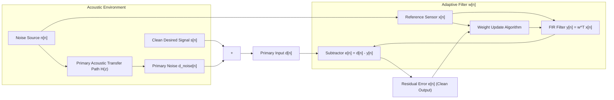

# Adaptive Algorithms & Mathematical Formulations

This document provides the formal mathematical foundations, algorithmic derivations, stability criteria, and fixed-point arithmetic rules for the three Adaptive Noise Cancellation (ANC) algorithms implemented in the project: **LMS**, **NLMS**, and **NLMS-Shift**.

---

## 1. ANC System Model & Problem Formulation

Adaptive Noise Cancellation relies on two simultaneous acoustic inputs:

1. **Primary Input ($d[n]$):** Captures the desired signal $s[n]$ contaminated by ambient noise:
   $$d[n] = s[n] + d_{\text{noise}}[n]$$
2. **Reference Input ($x[n]$):** Positioned near the acoustic noise source, picking up noise correlated with $d_{\text{noise}}[n]$ but isolated from $s[n]$:
   $$d_{\text{noise}}[n] = \sum_{j=0}^{\infty} h_j x[n-j]$$
3. **Adaptive FIR Filter Output ($y[n]$):** An $L$-tap transversal filter generates a synthesized estimate of the primary noise:
   $$y[n] = \mathbf{w}^T[n] \mathbf{x}[n] = \sum_{i=0}^{L-1} w_i[n] x[n-i]$$
   where:
   $$\mathbf{w}[n] = [w_0[n], w_1[n], \dots, w_{L-1}[n]]^T, \quad \mathbf{x}[n] = [x[n], x[n-1], \dots, x[n-L+1]]^T$$
4. **Error & System Output ($e[n]$):**
   $$e[n] = d[n] - y[n] = s[n] + \Big(d_{\text{noise}}[n] - y[n]\Big)$$
   As the adaptive weights converge to the optimal Wiener solution ($\mathbf{w}[n] \to \mathbf{h}$), the noise estimate cancels the primary contamination ($y[n] \approx d_{\text{noise}}[n]$), resulting in:
   $$e[n] \approx s[n]$$

---

## 2. Algorithm Formulations

### 2.1 Standard LMS (Least Mean Squares)

The LMS algorithm minimizes the Mean Square Error (MSE) cost function:
$$J[n] = \mathbb{E}\left\{e^2[n]\right\}$$
Using the instantaneous gradient approximation $\nabla_{\mathbf{w}} J[n] \approx \nabla_{\mathbf{w}} e^2[n] = -2 e[n] \mathbf{x}[n]$, the steepest-descent weight update is:

$$\mathbf{w}[n+1] = \mathbf{w}[n] + \mu\, e[n]\, \mathbf{x}[n]$$

- **Convergence & Stability:**  
  Stability is guaranteed if and only if the constant step size $\mu$ satisfies:
  $$0 < \mu < \frac{2}{\lambda_{\max}} < \frac{2}{\text{tr}(\mathbf{R}_x)} = \frac{2}{L \cdot \sigma_x^2}$$
  where $\mathbf{R}_x = \mathbb{E}\{\mathbf{x}[n]\mathbf{x}^T[n]\}$ is the autocorrelation matrix of the reference signal, and $\lambda_{\max}$ is its maximum eigenvalue.
- **Hardware Limitations:**  
  Because $\mu$ is fixed, LMS is vulnerable to **gradient noise amplification** when input signal energy increases, leading to overflow or divergence, and **slow convergence** when signal energy decreases.

---

### 2.2 Normalized LMS (NLMS)

NLMS solves the gradient amplification problem of LMS by normalizing the weight adjustment by the Euclidean energy of the input tap vector:
$$P[n] = \|\mathbf{x}[n]\|^2 = \sum_{i=0}^{L-1} x^2[n-i]$$

The regularized weight update is:

$$\mathbf{w}[n+1] = \mathbf{w}[n] + \frac{\mu}{\|\mathbf{x}[n]\|^2 + \epsilon}\, e[n]\, \mathbf{x}[n]$$

- **Regularization Factor ($\epsilon$):**  
  A small positive constant $\epsilon > 0$ prevents numerical divergence and division-by-zero during low-energy or silent audio intervals.
- **Stability Bounds:**  
  Convergence is guaranteed regardless of input power level when:
  $$0 < \mu < 2$$
  The optimal tracking rate for uncorrelated white noise occurs at $\mu \approx 1.0$.
- **Hardware Limitations:**  
  Evaluating the division $\frac{1}{P[n] + \epsilon}$ requires an on-chip iterative integer divider or reciprocal approximation table, increasing FPGA LE consumption and critical path latency.

---

### 2.3 NLMS-Shift (Power-of-2 Dividerless NLMS)

NLMS-Shift is a hardware-optimized algorithm that achieves the dynamic amplitude invariance of NLMS without requiring hardware division or explicit multiplier units for the step size.

#### Theoretical Derivation:
1. Define regularized input power:
   $$Q[n] = \|\mathbf{x}[n]\|^2 + \epsilon = \sum_{i=0}^{L-1} x^2[n-i] + \epsilon$$
2. Identify the position of the most significant bit (leading-one bit length):
   $$\text{bitlen}(Q) = \lfloor\log_2 Q[n]\rfloor + 1$$
   By definition of binary representation, $Q[n]$ is bounded within the dyadic octave:
   $$2^{\text{bitlen}(Q) - 1} \le Q[n] < 2^{\text{bitlen}(Q)}$$
3. Approximate the reciprocal denominator $\frac{1}{Q[n]}$ by the power-of-2 upper bound:
   $$\frac{1}{Q[n]} \approx 2^{-\text{bitlen}(Q)}$$
4. Constrain the normalized step size to an exact negative power of two:
   $$\mu = 2^{-K}, \quad K \in \mathbb{Z}^+$$
5. Combine the step size and denominator into a single dyadic shift operator:
   $$\frac{\mu}{Q[n]} \approx 2^{-K} \cdot 2^{-\text{bitlen}(Q)} = 2^{-(\text{bitlen}(Q) + K)}$$

The resulting tap update becomes:

$$\mathbf{w}[n+1] = \mathbf{w}[n] + e[n]\, \mathbf{x}[n] \cdot 2^{-(\text{bitlen}(Q[n]) + K)}$$

#### Mathematical Stability Proof:
The effective normalized step size $\mu_{\text{eff}}[n]$ realized by NLMS-shift satisfies:
$$\mu_{\text{eff}}[n] = \frac{Q[n]}{2^{\text{bitlen}(Q[n])}} \cdot 2^{-K}$$
Because $2^{\text{bitlen}(Q)-1} \le Q[n] < 2^{\text{bitlen}(Q)}$, it follows strictly that:
$$\frac{1}{2} \le \frac{Q[n]}{2^{\text{bitlen}(Q[n])}} < 1 \implies \frac{\mu}{2} \le \mu_{\text{eff}}[n] < \mu$$

**Theorem:** For any step parameter $K \ge 0$, the effective adaptation factor is strictly bounded between $50\%$ and $100\%$ of the ideal normalized step. Hence, NLMS-Shift is **unconditionally stable** and guarantees rapid tracking across non-stationary audio amplitudes without ever performing a division.

---

## 3. Algorithm Complexity & Performance Comparison

| Metric | LMS | NLMS | NLMS-Shift (Proposed) |
|---|---|---|---|
| **Multipliers per Sample** | $2L + 1$ | $2L + 3$ | **$2L$** |
| **Dividers per Sample** | None | 1 Multi-Cycle Divider | **None** |
| **Shift / Normalization** | Fixed arithmetic shift | None | **Leading-One + Barrel Shifter** |
| **Amplitude Invariance** | Poor (diverges on loud steps) | Excellent | **Excellent** |
| **Steady-State NR (dB)** | $20.3\text{ dB}$ | $20.7\text{ dB}$ | **$20.8\text{ dB}$** |
| **Tracking Time (Path Switch)** | $706\text{ ms}$ | $690\text{ ms}$ | **$674\text{ ms}$** |
| **Hardware Complexity** | Minimal | High (Divider LEs) | **Ultra-Low** |

---

## 4. Fixed-Point Arithmetic Contract

All mathematical operations inside `py/fixedpoint.py` and `rtl/anc_core.v` adhere to an exact signed fixed-point specification:

### 4.1 Number Format
- Signed two's complement $Q1.(W-1)$, where total width is $W$ and fractional bits $F = W - 1$.
- Range: $[-1.0, +1.0 - 2^{-F}]$, represented as integers in $[-2^{W-1}, +2^{W-1}-1]$.

### 4.2 Rounding: Round-Half-Up (`rs`)
Arithmetic right shifts incorporate round-half-up (ties rounded toward $+\infty$) to prevent negative bias accumulation:
$$\text{rs}(v, s) = (v + 2^{s-1}) \ggg s$$

### 4.3 Saturation Clamping (`sat`)
Every register assignment is bounded by saturation logic to eliminate catastrophic two's complement sign-inversion wrap:
$$\text{sat}_M(v) = \begin{cases}
2^{M-1} - 1, & \text{if } v \ge 2^{M-1} \\
-2^{M-1}, & \text{if } v < -2^{M-1} \\
v, & \text{otherwise}
\end{cases}$$

### 4.4 Tap Update Shift Calculations
- **LMS:** $\text{upd}_i = \text{rs}\Big((\text{MU\_INT} \cdot e) \cdot x[n-i],\; F + 10\Big)$
- **NLMS:** $g = \text{sat}_{W+4}\left(\left\lfloor \frac{2n + Q}{2Q} \right\rfloor\right)$ where $n = (\text{MU\_INT} \cdot e) \ll (2F - 10)$; $\quad \text{upd}_i = \text{rs}(g \cdot x[n-i], F)$
- **NLMS-Shift:** $\text{upd}_i = \text{rs}\Big(e \cdot x[n-i],\; \text{bitlen}(Q) - F + K\Big)$
- **Weight Accumulation:** $w_i[n+1] = \text{sat}_W(w_i[n] + \text{upd}_i)$
