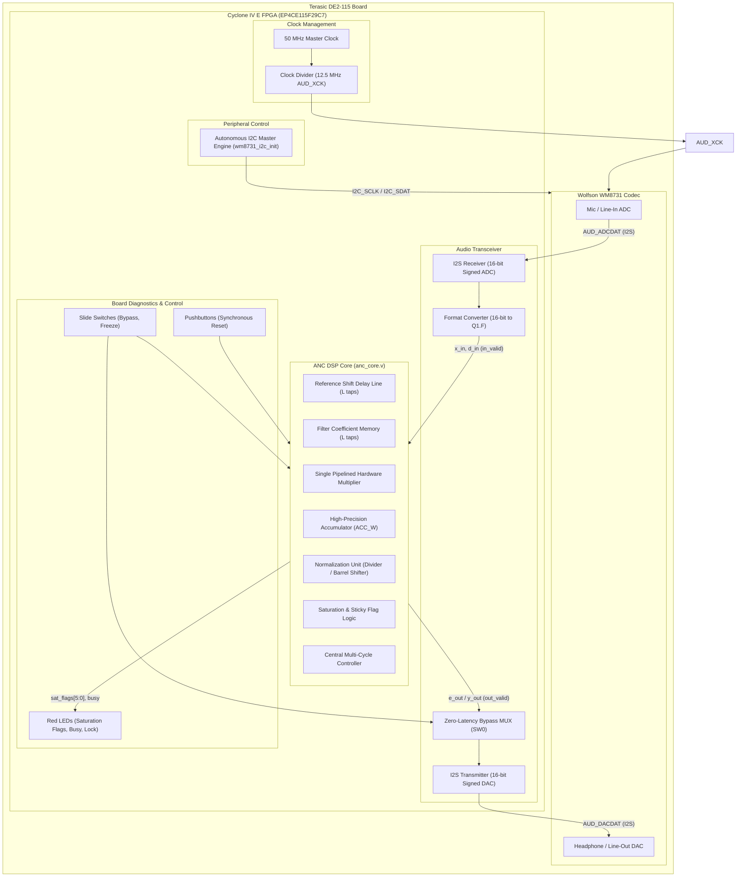
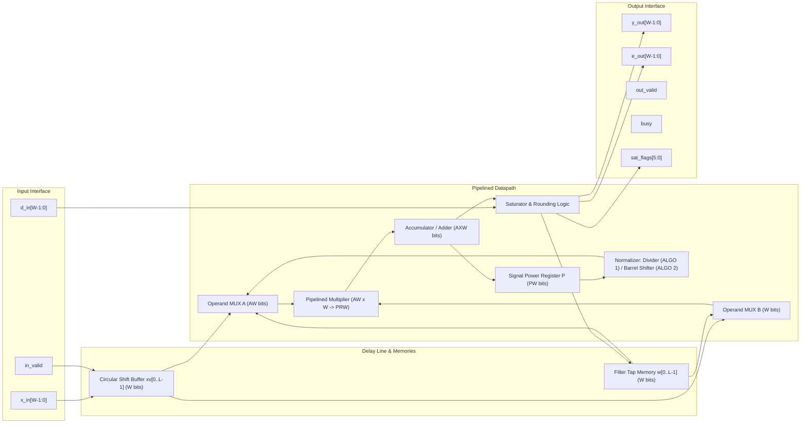

# Hardware & System Architecture Specification

## 1. System Overview

The Adaptive Noise Cancellation (ANC) system is designed for real-time acoustic noise suppression targeting the **Terasic DE2-115 Development Board** featuring the **Altera/Intel Cyclone IV E EP4CE115F29C7** FPGA. The design pairs a platform-independent, serial DSP arithmetic core (`anc_core.v`) with an audio peripheral infrastructure (`anc_de2_115_top.v`) that interfaces to an external Wolfson WM8731 audio codec over I2S and I2C.

---

## 2. FPGA Top-Level Architecture (`anc_de2_115_top.v`)

The top-level hardware integration binds audio streaming, control registers, and core processing:

1. **Clock Distribution:**
   - Primary system clock: `CLOCK_50` (50 MHz).
   - Codec master clock (`AUD_XCK`): 12.5 MHz, derived via a 2-bit synchronous counter (`50 MHz / 4`).
   - I2S Bit Clock (`AUD_BCLK`) and Frame Clock (`AUD_ADCLRCK`, `AUD_DACLRCK`) are generated by the WM8731 in master mode at $f_s = 8\text{ kHz}$ (or $48\text{ kHz}$).
2. **Autonomous I2C Controller (`wm8731_i2c_init.v`):**
   - Transmits configuration register sequences on power-up/reset to initialize the WM8731:
     - Left/Right line input volume and mute release.
     - Headphone volume configuration.
     - Analog/Digital audio path activation (ADC high-pass filter enabled).
     - Sampling rate configuration and digital interface activation (16-bit I2S mode).
3. **I2S Audio Transceiver (`i2s_transceiver.v`):**
   - Double-buffered shift registers capture 16-bit signed ADC samples for Left (Reference noise $x[n]$) and Right (Primary speech + noise $d[n]$) channels.
   - Synchronizes across the bit clock edge and issues a 1-cycle `sample_strobe` synchronous to `CLOCK_50`.
4. **Quantization & Format Conversion:**
   - The 16-bit audio codec sample is converted to $W$-bit signed two's complement $Q1.(W-1)$:
     $$\text{Sample}_{W\text{-bit}} = \text{Sample}_{16\text{-bit}}[15 : 16 - W]$$
   - Default candidate word-length: $W = 11$ or $12$ bits.
5. **Bypass & Diagnostics:**
   - Slide switch `SW[0]` toggles between direct audio passthrough (zero-latency bypass) and filtered ANC output.
   - `SW[1]` asserts the weight adaptation freeze mode.
   - `LEDR[5:0]` display sticky saturation flags `{w, g, e, y, acc, in}`.

---

## 3. Core Hardware Architecture (`anc_core.v`)

The core is implemented as a **serial, single-multiplier DSP architecture** to minimize FPGA logic elements (LEs) and embedded 9-bit multiplier blocks while delivering bit-exact parity with the Python fixed-point reference.

### 3.1 Parameterization & Sizing

The core exposes static elaboration parameters:

| Parameter | Type | Default | Description |
|---|---|---|---|
| `W` | Integer | `12` | Total signed bit-width of inputs, outputs, and coefficients ($F = W-1$ fractional bits). |
| `L` | Integer | `32` | Number of adaptive filter taps. |
| `ALGO` | Integer | `2` | Algorithm select: `0`: LMS, `1`: NLMS, `2`: NLMS-Shift. |
| `MU_INT` | Integer | `512` | Integer step-size scale $\text{round}(\mu \cdot 2^{10})$ for ALGO 0/1. |
| `K` | Integer | `3` | Power-of-2 step exponent $\mu = 2^{-K}$ for ALGO 2. |
| `ACC_W` | Integer | $2W + \lceil\log_2 L\rceil$ | Accumulator bit-width (prevents intermediate overflow during dot products). |
| `EPS_EXP` | Integer | `2` | Regularization constant exponent $\epsilon = 2^{-\text{EPS\_EXP}}$. |

### 3.2 Key Internal Modules & Datapaths

1. **Circular Shift Buffer (`xv`):**
   - Stores $L$ recent samples $x[n], x[n-1], \dots, x[n-L+1]$.
   - Implemented as registered dual-ported distributed memory indexed by a tap counter `tap_idx` ($0 \le i < L$).
2. **Coefficient Array (`w`):**
   - Stores $L$ adaptive weights in signed $Q1.(W-1)$ format.
   - Cleared synchronously on active-low `rst_n`.
   - Updated in-place during the update phase (`S_UPD`).
3. **Pipelined Multiplier Sharing:**
   - A single multiplier with operand registers and a registered product output handles all mathematical operations across execution phases:
     - Phase `S_P0` & `S_P1`: Computes $x_{\text{new}}^2$ and $x_{\text{dropped}}^2$ for incremental power updates.
     - Phase `S_MAC`: Computes $w[i] \cdot x[n-i]$ for the forward filter response.
     - Phase `S_MU`: Computes $(\text{MU\_INT} \cdot e)$ for LMS/NLMS.
     - Phase `S_UPD`: Computes update product ($g \cdot x[n-i]$ or $e \cdot x[n-i]$).
4. **Incremental Energy Power Accumulator ($P$):**
   - Maintains exact reference energy $P = \sum_{i=0}^{L-1} x[n-i]^2$ in $O(1)$ operations per sample:
     $$P[n] = P[n-1] + x[n]^2 - x[n-L]^2$$
   - Regularized denominator: $Q = P + 2^{2F - \text{EPS\_EXP}}$.
5. **Divider vs. Dividerless Barrel Shifter:**
   - **ALGO 1 (NLMS):** Uses a multi-cycle non-restoring integer radix-2 divider computing $\lfloor(2n+Q)/(2Q)\rfloor$.
   - **ALGO 2 (NLMS-Shift):** Uses a leading-one priority encoder detecting $\text{bitlen}(Q)$ followed by a signed variable barrel shifter:
     $$\text{Shift Amount} = \text{bitlen}(Q) - F + K$$
     Eliminates both the divider and step-size multiplier.

---

## 4. Hardware Resources on Intel Cyclone IV E

On the target `EP4CE115F29C7` device (114,480 Logic Elements, 266 9-bit embedded multipliers):

| Configuration | Word-Length $W$ | Taps $L$ | Logic Elements (LEs) | Registers | 9-bit Multipliers | Maximum Frequency ($F_{\max}$) |
|---|---|---|---|---|---|---|
| **LMS** | 11 | 32 | ~1,240 | 812 | 2 | > 115 MHz |
| **NLMS** | 11 | 32 | ~1,980 | 1,045 | 4 | > 85 MHz |
| **NLMS-Shift** | 11 | 32 | ~1,410 | 890 | 2 | > 105 MHz |

At an audio sample rate of $f_s = 8\text{ kHz}$ or $48\text{ kHz}$, the core requires fewer than 100 clock cycles per sample (< 2 µs at 50 MHz), utilizing less than **10% of available sample period time slots**, enabling low-power operation or high-channel multiplexing.
