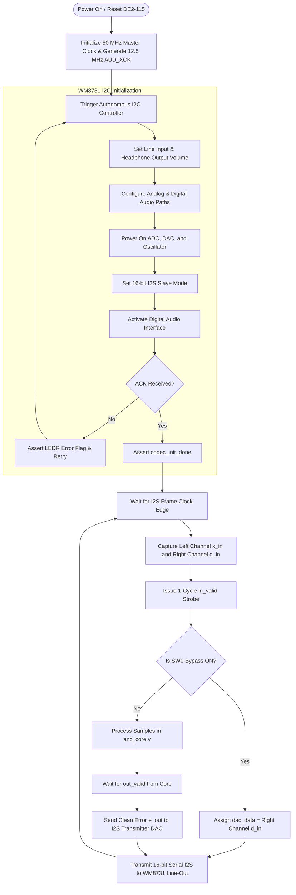
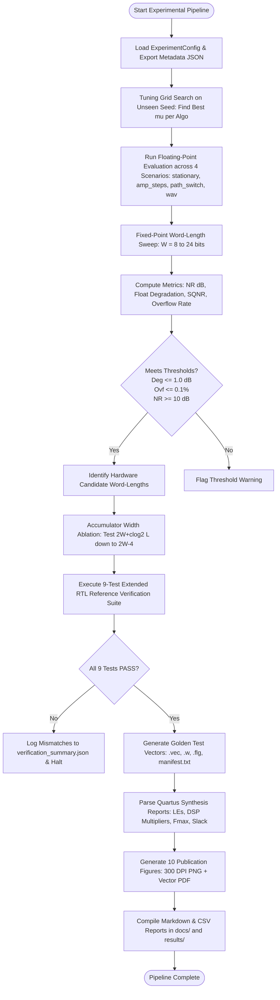

# System & Hardware Flowcharts

This document compiles the operational flowcharts for the complete Adaptive Noise Cancellation system across board initialization, RTL finite state machine control, algorithmic branching, and simulation pipelines.

---

## 1. Top-Level System Operation Flowchart



---

## 2. ANC Core Hardware FSM State Machine

The core finite state machine in [`rtl/anc_core.v`](../../rtl/anc_core.v) orchestrates multi-cycle single-multiplier scheduling:

```mermaid
stateDiagram-v2
    [*] --> S_IDLE

    S_IDLE --> S_P0 : in_valid = 1 & busy = 0\n(Latch x_in, d_in; shift delay line)
    S_IDLE --> S_IDLE : in_valid = 0\n(Hold outputs, busy = 0)

    state "Phase 1: Incremental Power Update" as P_PHASE {
        S_P0 --> S_P1 : If ALGO != 0\n(Issue x_new^2 to multiplier)
        S_P1 --> S_MAC : Issue x_old^2 to multiplier;\nP += x_new^2 - x_old^2
    }
    S_P0 --> S_MAC : If ALGO == 0 (LMS)\n(Skip power calculation)

    state "Phase 2: Forward FIR Filtering" as MAC_PHASE {
        S_MAC --> S_MAC : tap_idx < L-1\n(Issue w[i] * x[n-i] product)
        S_MAC --> S_WAIT : tap_idx == L-1\n(Finish issuing L products)
        S_WAIT --> S_YE : Pipeline drain (2 cycles)\nAccumulator holds sum(w_i * x_i)
    }

    state "Phase 3: Output Formation & Gain Step" as OUT_PHASE {
        S_YE --> S_MU : Form y = sat(rs(acc, F)), e = sat(d - y)\nAssert out_valid = 1
        S_MU --> S_MU2 : If ALGO == 1 (NLMS)\n(Issue MU_INT * e)
        S_MU2 --> S_DIV : Prepare dividend n = (MU*e) << (2F-10)
        S_DIV --> S_UPD : Iterative non-restoring divider finishes;\ng = sat(floor((2n+Q)/(2Q)))
        S_MU --> S_UPD : If ALGO == 0 (LMS)\n(Issue MU_INT * e)
        S_YE --> S_UPD : If ALGO == 2 (NLMS-Shift)\n(Leading-one detector finds bitlen(Q);\nCompute shift S = bitlen(Q) - F + K)
    }

    state "Phase 4: Weight Update & Drain" as UPD_PHASE {
        S_UPD --> S_UPD : tap_idx < L-1\n(Issue upd[i] * x[n-i] to multiplier)
        S_UPD --> S_WAIT : tap_idx == L-1\n(Finish issuing L updates)
        S_WAIT --> S_IDLE : Pipeline drain (3 cycles)\nAll w[i] saturated & written back;\nDeassert busy = 0
    }
```

---

## 3. Algorithm Selection & Arithmetic Execution Logic

```mermaid
flowchart TD
    SAMPLE_IN[Sample Accepted: x[n], d[n]] --> CALC_MAC[Compute Forward FIR Filter: acc = sum w_i * x_n_i]
    CALC_MAC --> FORM_OUT[Form Output: y[n] = sat_W rs acc, F; e[n] = sat_W d - y]
    FORM_OUT --> OUT_STROBE[Assert out_valid = 1]

    OUT_STROBE --> CHECK_FREEZE{SW1 Freeze Active?}
    CHECK_FREEZE -- Yes (mu = 0) --> BYPASS_UPDATE[Skip Weight Adaptation; w_i remains unchanged]
    BYPASS_UPDATE --> DONE[Return to S_IDLE]

    CHECK_FREEZE -- No --> ALGO_BRANCH{ALGO Parameter}

    subgraph LMS_Path ["ALGO 0: Standard LMS"]
        ALGO_BRANCH -- ALGO = 0 --> LMS_MULT[Compute prod = MU_INT * e]
        LMS_MULT --> LMS_TAP[For each tap i: upd_i = rs prod * x_n_i, F+10]
    end

    subgraph NLMS_Path ["ALGO 1: Normalized LMS"]
        ALGO_BRANCH -- ALGO = 1 --> NLMS_POW[Compute Q = P + 2^2F-EPS_EXP]
        NLMS_POW --> NLMS_DIV[Execute Multi-Cycle Integer Division: g = sat floor 2n+Q / 2Q]
        NLMS_DIV --> NLMS_TAP[For each tap i: upd_i = rs g * x_n_i, F]
    end

    subgraph SHIFT_Path ["ALGO 2: NLMS-Shift"]
        ALGO_BRANCH -- ALGO = 2 --> SHIFT_POW[Compute Q = P + 2^2F-EPS_EXP]
        SHIFT_POW --> SHIFT_LOD[Leading-One Detector: ex = bitlen Q]
        SHIFT_LOD --> SHIFT_CALC[Calculate Dynamic Exponent: S = ex - F + K]
        SHIFT_CALC --> SHIFT_TAP[For each tap i: upd_i = rs e * x_n_i, S via Barrel Shifter]
    end

    LMS_TAP --> WRITEBACK[Update Tap Weight: w_i = sat_W w_i + upd_i]
    NLMS_TAP --> WRITEBACK
    SHIFT_TAP --> WRITEBACK
    WRITEBACK --> DONE
```

---

## 4. Fixed-Point Rounding & Saturation Flag Logic

```mermaid
flowchart TD
    RAW_VAL[Input Integer Intermediate Value v] --> OP_SELECT{Operation Stage}

    subgraph Rounding_Unit ["Round-Half-Up rs(v, s)"]
        OP_SELECT -- Rounding --> ADD_HALF[v_rounded = v + 2^s-1]
        ADD_HALF --> ARITH_SHIFT[v_shifted = v_rounded >>> s]
    end

    subgraph Saturation_Unit ["Saturation & Sticky Flags"]
        ARITH_SHIFT --> CLAMP_CHECK{Exceeds [-2^M-1, +2^M-1 - 1]?}
        OP_SELECT -- Direct Check --> CLAMP_CHECK
        CLAMP_CHECK -- Exceeds Positive Max --> SAT_POS[Clamp to +2^M-1 - 1]
        CLAMP_CHECK -- Exceeds Negative Min --> SAT_NEG[Clamp to -2^M-1]
        CLAMP_CHECK -- In Range --> SAT_NONE[Retain v]

        SAT_POS --> SET_FLAG[Assert Matching Bit in sat_flags]
        SAT_NEG --> SET_FLAG
        SAT_NONE --> KEEP_FLAG[Keep Existing Flag State]

        SET_FLAG --> STICKY_REG[LATCH in Sticky Register sat_flags[5:0]]
        KEEP_FLAG --> STICKY_REG
    end

    STICKY_REG --> FINAL_VAL[Assigned to Destination Register]
```

---

## 5. Software Research & Verification Pipeline Flowchart


