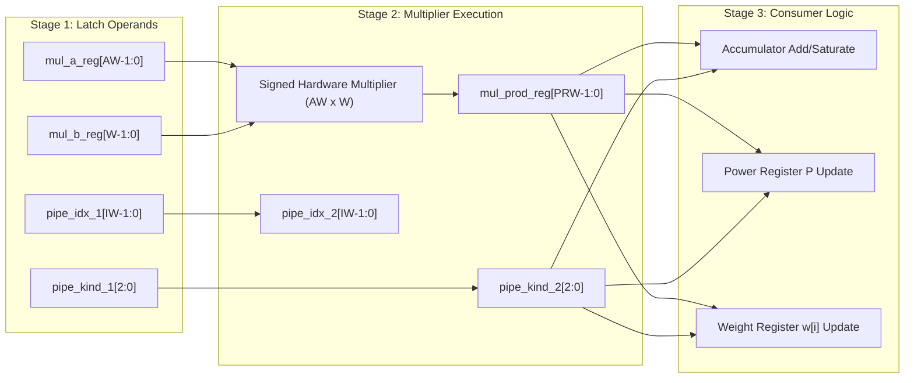
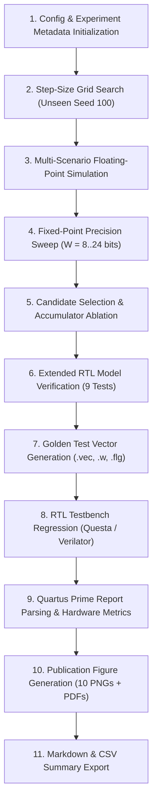

# Pipeline Specifications: Hardware Execution & Verification

This document specifies the two complementary pipelines of the ANC project:
1. **The RTL Hardware Execution Pipeline:** Cycle-accurate pipelined micro-architecture within `anc_core.v`.
2. **The Software Research & Verification Pipeline:** Automated workflow from parameter optimization to hardware characterization.

---

## 1. RTL Hardware Execution Pipeline

The `anc_core` architecture adopts a serial, time-multiplexed multiplier datapath with a registered 3-stage execution pipeline. This design avoids placing long multiplier and accumulator logic in a single combinatorial path, maximizing the operational clock frequency ($F_{\max} > 100\text{ MHz}$) on Cyclone IV E.

```mermaid
gantt
    title ANC Core Per-Sample Hardware Schedule (L=32 Taps)
    dateFormat X
    axisFormat %s

    section Input
    Sample Arrival (in_valid)  :milestone, 0, 0
    busy Asserted              :active, 0, 75

    section Phase 1: Power
    P0: Issue x_new^2          :crit, 1, 3
    P1: Issue x_dropped^2      :crit, 2, 4
    P Incremental Update       :done, 4, 5

    section Phase 2: Filtering
    Issue MAC Products (w_i * x_i): 3, 35
    MAC Pipeline Drain (2 cycles) : 35, 37
    Output Assertion (out_valid)  :milestone, 37, 37
    Output Error Formed (e = d-y) :done, 37, 38

    section Phase 3: Gain/Step
    Issue Step Multiplier (mu * e): 38, 40
    Leading-1 Detect / Divide    : 40, 42

    section Phase 4: Weight Update
    Issue Updates (upd_i * x_i)  : 42, 74
    Update Pipeline Drain        : 74, 76
    Taps Written to Memory       : 44, 76
    busy Deasserted              :milestone, 76, 76
```

### 1.1 Multiplier Hardware Pipeline Stages

To optimize timing closure, the shared arithmetic multiplier is partitioned into three synchronous stages:

$$\text{Stage 1: Operand Latching} \longrightarrow \text{Stage 2: Pipelined Product} \longrightarrow \text{Stage 3: Result Consumption}$$

1. **Stage 1 (Operand Registration):**
   - At clock cycle $k$, state controller evaluates current phase and registers `mul_a_reg` and `mul_b_reg`.
   - Pipeline metadata tags (`pipe_kind_1` and `pipe_idx_1`) track the operation type (`K_P0`, `K_P1`, `K_MAC`, `K_MU`, `K_UPD`) and tap index $i$.
2. **Stage 2 (Multiplier Latching):**
   - At clock cycle $k+1$, multiplier produces the signed product into `mul_prod_reg`:
     $$\text{mul\_prod\_reg} \le \text{mul\_a\_reg} \times \text{mul\_b\_reg}$$
   - Operation tags propagate to `pipe_kind_2` and `pipe_idx_2`.
3. **Stage 3 (Accumulation & State Update):**
   - At clock cycle $k+2$, product is consumed according to `pipe_kind_2`:
     - If `K_MAC`: Product is added to the running filter accumulator `acc_reg`.
     - If `K_P0`: Added to incremental power $P \leftarrow P + x_{\text{new}}^2$.
     - If `K_P1`: Subtracted from incremental power $P \leftarrow P - x_{\text{dropped}}^2$.
     - If `K_UPD`: Saturated and written directly into tap register $w[i]$.

### 1.2 Cycle-Accurate Timing Schedule

For filter length $L$ (default $L=32$):

| Cycle Range | State | Actions Performed | Active Multiplier Operation |
|---|---|---|---|
| **Cycle 0** | `S_IDLE` | Strobe `in_valid=1` sampled. Samples $x[n], d[n]$ latched; `busy` goes high. Circular buffer shifts new sample in. | None |
| **Cycle 1** | `S_P0` | Latch $x[n]$ into multiplier operands. | Computes $x_{\text{new}}^2$ |
| **Cycle 2** | `S_P1` | Latch $x[n-L]$ into multiplier operands. | Computes $x_{\text{dropped}}^2$ |
| **Cycle 3 to $L+2$** | `S_MAC` | Sequentially issue $w[i] \cdot x[n-i]$ for $i = 0 \dots L-1$. | Computes $L$ tap products |
| **Cycle $L+3, L+4$** | `S_WAIT` | Multiplier pipeline drains final tap products into accumulator. | Final 2 products drain |
| **Cycle $L+5$** | `S_YE` | Form $y[n] = \text{sat}_W(\text{rs}(acc, F))$, $e[n] = \text{sat}_W(d[n] - y[n])$. Assert **`out_valid = 1`**. | None |
| **Cycle $L+6, L+7$** | `S_MU` / `S_DIV` | Compute normalized gain $g$ or shift amount $S$. | Step product / shift extract |
| **Cycle $L+8$ to $2L+7$** | `S_UPD` | Sequentially issue weight update products for $i = 0 \dots L-1$. | Computes $L$ update terms |
| **Cycle $2L+8, 2L+9$** | `S_WAIT` | Pipeline drains; last updated weights written to memory array. | Final 2 update products drain |
| **Cycle $2L+10$** | `S_IDLE` | De-assert `busy = 0`. Core is ready for next audio sample. | Idle |

- **Output Latency ($LAT$):**
  - **LMS (ALGO 0):** $LAT = L + 3$ cycles ($35$ cycles for $L=32$).
  - **NLMS / NLMS-Shift (ALGO 1 / 2):** $LAT = L + 5$ cycles ($37$ cycles for $L=32$).
- **Total Sample Processing Time:** $T_{\text{proc}} \approx 2L + 12$ clock cycles (~76 clock cycles). At 50 MHz, this corresponds to **$1.52\ \mu\text{s}$**, easily satisfying the $125\ \mu\text{s}$ budget of $8\text{ kHz}$ audio.

---

## 2. Software Research & Verification Pipeline

The software engineering pipeline (`py/run_pipeline.py`) unifies mathematical reference modeling, hardware constraints, golden vector generation, and publication-ready visualization into an autonomous execution loop:

### 2.1 Stage Breakdown & Responsibilities

1. **Step-Size Tuning (`py/algos.py`):**
   - Tunes optimal step-size parameters on an isolated random seed (`seed=100`) across a geometric grid:
     - LMS: $\mu \in [0.05, 20]$ across 14 points.
     - NLMS: $\mu \in [0.01, 1.0]$ across 13 points.
     - NLMS-Shift: $\mu \in 2^{-\{0 \dots 8\}}$ (9 power-of-2 points).
2. **Floating-Point Baseline (`py/signals.py`, `py/metrics.py`):**
   - Evaluates convergence across four standardized test scenarios:
     - `stationary`: Stationary coloured noise generated via 5th-order Butterworth low-pass filter ($f_c = 1500\text{ Hz}$).
     - `amp_steps`: Abrupt $\pm 6\text{ dB}$ step amplitude transitions testing energy tracking.
     - `path_switch`: Acoustic transfer function switches abruptly from $H_1(z)$ to $H_2(z)$ at $t = 1.0\text{ s}$.
     - `wav`: Real acoustic chord recordings (`acoustic_chord.wav`).
3. **Fixed-Point Word-Length Sweep (`py/fixedpoint.py`):**
   - Characterizes finite word-length effects across $W \in [8, 24]$ bits.
   - Computes noise reduction (dB), degradation vs. double-precision float, and signal-to-quantization-noise ratio (SQNR).
4. **Hardware Candidate Selection:**
   - Filters candidates satisfying strict engineering gates:
     - Degradation vs. float: $\le 1.0\text{ dB}$ (mean), $\le 3.0\text{ dB}$ (max).
     - Overflow rate: $\le 0.1\%$.
     - Absolute noise reduction: $\ge 10.0\text{ dB}$.
5. **Accumulator Width Ablation:**
   - Evaluates accumulator widths: $2W + \lceil\log_2 L\rceil$, $2W$, $2W - 2$, and $2W - 4$ bits.
   - Pinpoints minimal accumulator bit-width before catastrophic overflow occurs.
6. **RTL Reference Verification (`py/verify_core.py`):**
   - Rigorously checks 9 critical RTL verification vectors against Python reference:
     - Synchronous reset state clearing.
     - Algorithm mode multiplexing (0, 1, 2).
     - Weight freezing under $\mu = 0$.
     - Boundary rail saturation ($[-2^{W-1}, +2^{W-1}-1]$).
     - Accumulator sticky saturation flags.
     - 6,000-sample sustained numerical stability without drift.
     - WAV audio execution.
7. **Synthesis & Hardware Metrics Integration (`py/import_quartus.py`):**
   - Parses Intel Quartus Prime Lite compilation reports (`.fit.rpt`, `.sta.rpt`, `.pow.rpt`) for LE usage, DSP blocks, $F_{\max}$, and setup slack.
8. **Visualization Suite (`py/visualize.py`):**
   - Exports all 10 figures in both 300 DPI PNG and vector PDF format to `results/plots/`.
